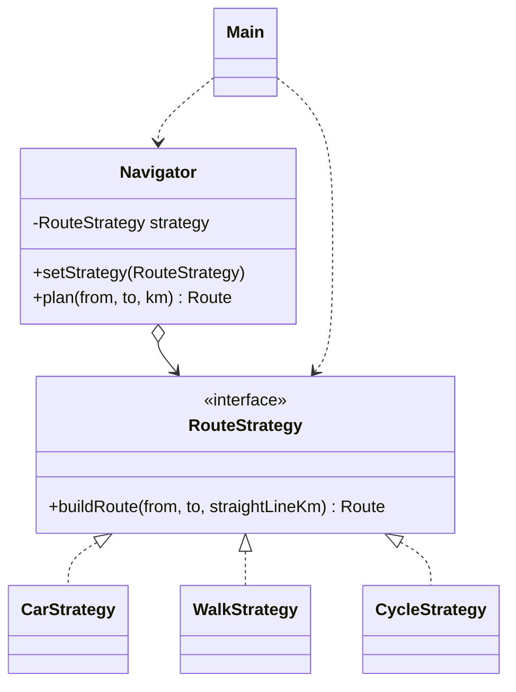

# Assignment 5 — Strategy Pattern

**Student:** Sissenbay Rassul, group se2538

## 1. Introduction
Domain: navigation / route planning. The algorithm family is "how to build a route":
by car, on foot, by bike. Each differs in distance factor and average speed, and the
user can change the mode at runtime.

## 2. UML class diagram


## 3. Clean Code
**1. No conditional logic — polymorphism instead.**
Before:
```java
if (mode.equals("car")) { ... } else if (mode.equals("walk")) { ... } else if (mode.equals("cycle")) { ... }
```
After: `strategy.buildRoute(from, to, km);` — the right algorithm runs by polymorphism.

**2. Intention-revealing names.** `CarStrategy`, `WalkStrategy`, `CycleStrategy`,
`buildRoute`, constants `ROAD_FACTOR`, `AVERAGE_SPEED_KMH` instead of magic numbers 1.3 and 50.

**3. Single Responsibility.** Each strategy contains exactly one algorithm
(e.g. `WalkStrategy` only computes a walking route). Navigator only delegates.

**4. Context is algorithm-agnostic.**
```java
public Route plan(String from, String to, double km) { return strategy.buildRoute(from, to, km); }
```
Navigator does not import or know any concrete strategy.

**5. Easy extensibility (Open/Closed).** Adding `ScooterStrategy` requires a new class
and one line in `Main`; existing classes are untouched.

**6. Immutability / small functions.** `Route` is a `record`; each method is short and does one thing.

## 4. Strategy vs. State
The mode of transport is chosen by the client from outside and is just a different way
to do the same job; strategies don't know about each other and never switch themselves.
In State, the object's own behavior changes as its internal state changes, and the
states themselves usually trigger transitions to other states. Here nothing triggers
transitions, so Strategy fits.

## 5. Conclusion
We added 4 small classes/interfaces, but got an `if`-free Navigator and the ability to
add new modes and switch at runtime without modifying existing code. The cost is more
files; the gain is flexibility and testability.